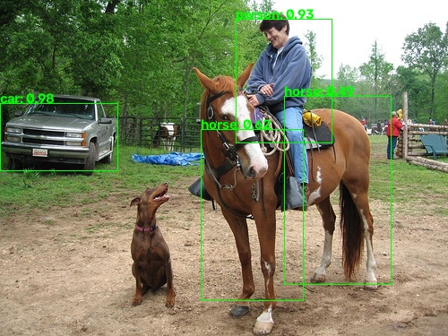

# R-CNN from Scratch | Object Detection

A traditional **Region-based Convolutional Neural Network (R-CNN)** implementation using Python, PyTorch, OpenCV, and Scikit-learn.

The project implements object detection using Selective Search, AlexNet feature extraction, SVM classification, Bounding Box Regression, and Non-Maximum Suppression.

## Architecture

```text
Input Image
    |
Selective Search
    |
Region Proposals
    |
AlexNet Feature Extraction
    |
SVM Classification
    |
Bounding Box Regression
    |
Non-Maximum Suppression
    |
Final Detections
```

## Project Structure

```text
RCNN-from-Scratch/
│
├── R-CNN/
│   ├── voc_dataset.py
│   ├── selective_search.py
│   ├── utils.py
│   ├── box_ops.py
│   ├── dataset_preparation.py
│   ├── extractor.py
│   ├── train.py
│   ├── evaluate.py
│   ├── inference.py
│   ├── visualization.py
│   ├── model_saver.py
│   ├── model_loader.py
│   └── main.py
│
├── Models/
│   └── rcnn_model.joblib
│
├── Examples/
│   └── VOC Single Image Demo.py
│
├── Experiments/
│   ├── bbox_regression_demo.py
│   ├── iou_broadcasting_demo.py
│   └── index.html
│
├── Test Images/
├── Run Inference.py
├── output.jpg
├── requirements.txt
├── .gitignore
└── README.md
```

## Dataset

**Pascal VOC 2010** — more than 11,000 images across 20 object categories: Aeroplane, Bicycle, Bird, Boat, Bottle, Bus, Car, Cat, Chair, Cow, Dining Table, Dog, Horse, Motorbike, Person, Potted Plant, Sheep, Sofa, Train, and TV Monitor.

## Training

Due to local hardware limitations, the model was trained on only **200 images** from the dataset.

- Hardware: Local laptop CPU (no dedicated GPU).
- Training time: Approximately 6 hours.
- Dataset limitation: The full dataset contains more than 11,000 images.
- The training subset was limited to avoid excessive memory consumption and potential memory crashes.

Traditional R-CNN is computationally expensive because of its region proposal generation and CNN feature extraction stages.

## Evaluation Results

### SVM Classifier

| Metric | Result |
|---|---:|
| Accuracy | 79.68% |
| Macro Recall | 6.56% |
| Person Recall | 38% |
| Background Recall | 100% |

### Bounding Box Regression

| Metric | Result |
|---|---:|
| Mean IoU Before Regression | 0.6739 |
| Mean IoU After Regression | 0.6505 |

### Object Detection

| Metric | Result |
|---|---:|
| mAP@0.5 | 0.1330 |

The results are limited by the small training subset and class imbalance. Training on more representative data could improve classification and localization performance, although further optimization would also be required.

## Detection Results

The following image shows an actual inference result produced by the trained model.



The model detected multiple objects, including cars, persons, and horses. Some overlapping detections and missed objects remain.

## Installation

Clone the repository:

```bash
git clone https://github.com/Salah-Mostafa/RCNN-from-Scratch.git
cd RCNN-from-Scratch
```

Install dependencies:

```bash
pip install -r requirements.txt
```

## Run Inference

Place an image inside `Test Images/`, update its path in `Run Inference.py`, and execute:

```bash
python "Run Inference.py"
```

The script loads the saved model and performs object detection without retraining.

## Training

To run the complete training and evaluation pipeline:

```bash
python -m R-CNN.main
```

Note: This command starts training again and may take several hours. The trained model is already saved in the `Models` directory.

## Examples & Experiments

- **Examples:** Single-image Pascal VOC demonstration using Selective Search and IoU-based proposal selection.
- **Bounding Box Regression Demo:** Visualizes bounding box refinement.
- **IoU Broadcasting Demo:** Demonstrates pairwise IoU calculation using NumPy broadcasting.
- **Interactive IoU Dashboard:** Explores bounding box overlaps and IoU values.

## Technologies

Python | PyTorch | Torchvision | OpenCV | NumPy | Scikit-learn | Matplotlib | Joblib

## Future Improvements

- Train on a larger portion of Pascal VOC.
- Improve class balance and classification performance.
- Improve bounding box regression.
- Optimize inference speed and detection accuracy.

---

**Project Focus:** Understanding and implementing the traditional R-CNN object detection pipeline by combining deep learning feature extraction with classical machine learning.